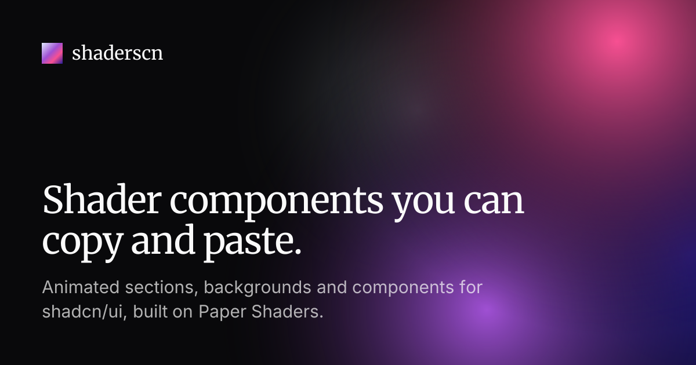

# shaderscn

Copy-paste shader sections and components for shadcn/ui, built on [Paper Shaders](https://shaders.paper.design) (`@paper-design/shaders-react`).

Browse the shaders and read the docs at [shaderscn.com](https://www.shaderscn.com).

## Installing a shader

`@shaderscn` is listed in the shadcn registry directory, so there's nothing to configure. If your project doesn't use shadcn yet, set it up first:

```bash
npx shadcn@latest init
```

Then add any shader by name:

```bash
npx shadcn@latest add @shaderscn/god-rays-hero
```

The CLI also installs `@paper-design/shaders-react` and any shadcn components the shader uses. On an older version of the CLI, install from the URL instead:

```bash
npx shadcn@latest add https://www.shaderscn.com/r/god-rays-hero.json
```

Prefer to skip the CLI? Every shader page on the site has a Manual tab with the dependencies to install and the complete source to paste. See [Get started](https://www.shaderscn.com/docs) for usage and customization.

## Development

```bash
pnpm install
pnpm dev
```

`dev` and `build` run `shadcn build` first, which turns `registry.json` into installable JSON in `public/r/`. That folder is generated and isn't committed.

Set `NEXT_PUBLIC_REGISTRY_URL` so the URL install commands on the site point at your deployment (it defaults to the `homepage` in `registry.json` in production and `http://localhost:3000` in development). The same URL is used for canonical links, the sitemap and `robots.txt`.

## Adding a new shader

1. Create `registry/shaders/<name>/<name>.tsx`. Import `cn` from `@/lib/utils` and shadcn UI from `@/components/ui/*` so the CLI can rewrite the imports for each user's project.
2. Add an item to `registry.json`. Use `registry:block` for full sections and `registry:component` for everything else. List `@paper-design/shaders-react` under `dependencies` and any shadcn components under `registryDependencies`. The first entry in `categories` (`sections`, `backgrounds` or `components`) sets its group in the docs sidebar.
3. Add a preview and a usage snippet to `registry/previews.tsx`. The preview `layout` sets how it's shown on the site:
   - `section`: rendered at desktop width
   - `component`: centered on a canvas
   - `background`: stretched to fill the frame

## Acknowledgements

The shaders are powered by [Paper Shaders](https://shaders.paper.design) by [Paper](https://paper.design) (`@paper-design/shaders-react`, Apache-2.0). shaderscn is an independent project and isn't affiliated with Paper.
